<!--
  ═══════════════════════════════════════════════════════════════════════
   DummyStrophael · PROFILE README  ·  theme: NIGHT CITY GRID / AUDIO LINK
   改文字  → 直接改这个文件
   改横幅 / 音乐卡 / 卡片 / 配色 → 改 build_assets.py，然后 python build_assets.py
   上线步骤 → 使用说明.md
  ═══════════════════════════════════════════════════════════════════════
-->

  

  
  
  

  

<h3 align="center"><code>⟨ 01 ⟩&nbsp; WHOAMI</code></h3>

  

  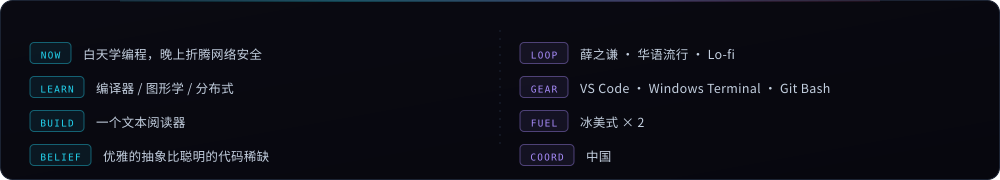

<h3 align="center"><code>⟨ 02 ⟩&nbsp; AUDIO LINK</code></h3>

  <a href="https://dummystrophael.github.io/DummyStrophael/playlist/" title="点开听我在听什么">
    
  </a>

  最喜欢的歌是天外来物，最喜欢的歌手是薛之谦

<h3 align="center"><code>⟨ 03 ⟩&nbsp; ARSENAL</code></h3>

<!-- 技术栈在 build_assets.py 的 STACK 里改，改完运行 python build_assets.py -->

  常用武器库 · 持续升级中

  

<h3 align="center"><code>⟨ 04 ⟩&nbsp; PROJECTS</code></h3>

  已上线 / 施工中 · 保持更新

<table align="center" border="0" cellpadding="0" cellspacing="0" width="100%">
  <tr>
    <td width="48%" align="center" valign="top">
      <a href="https://github.com/DummyStrophael/Tasks">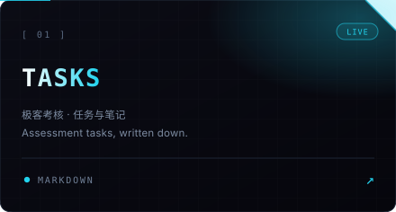</a>
    </td>
    <td width="4%"></td>
    <td width="48%" align="center" valign="top">
      
    </td>
  </tr>
</table>

  ▸ 在折腾 · 给VMware装上黑苹果

  
<b>&lt;05&gt; ARCHIVE</b> · 我喜欢 · 前 19 首（点开）

 

| 封面 | 曲目 | 歌手 |
|:--:|:--|:--|
|  | 最佳歌手 (Live) | 薛之谦 · 许嵩 |
| 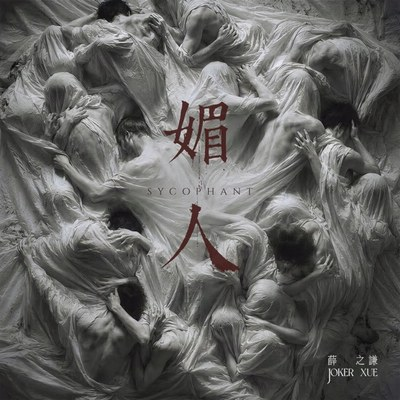 | 媚人 | 薛之谦 |
|  | 崇拜 | 薛之谦 |
| 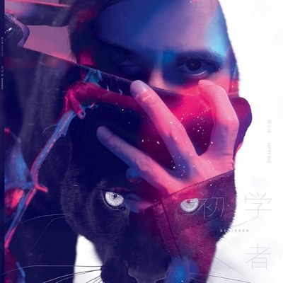 | 我好像在哪见过你 | 薛之谦 |
|  | 一半 | 薛之谦 |
|  | 爱好 (2024 现场) | 薛之谦 |
| 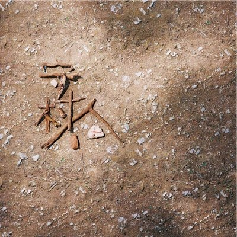 | 念 | 薛之谦 |
|  | 关于你 | 薛之谦 |
| 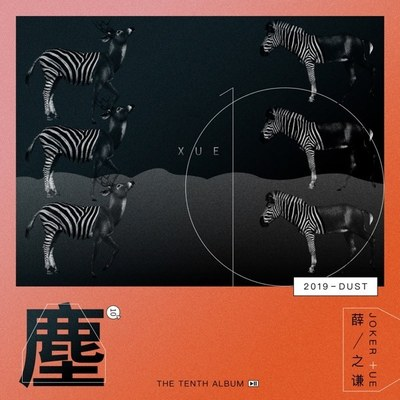 | 配合 | 薛之谦 |
|  | 火星人来过 | 薛之谦 |
| 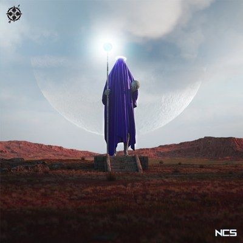 | Royalty | Egzod · Maestro Chives |
|  | 锤子 (feat. 范丞丞) | KnowKnow · 范丞丞 |
|  | AI | 薛之谦 |
|  | 无数 | 薛之谦 |
| 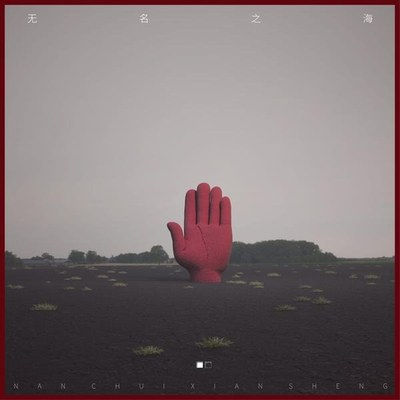 | 无名之海 | 石岩 |
|  | 陪你去流浪 | 薛之谦 |
|  | Die For You | Grabbitz |
|  | Teeth | 5 Seconds of Summer |
| 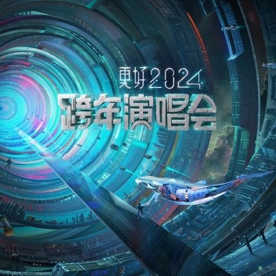 | 丑八怪 (Live) | 薛之谦 |

封面墙与整份歌单 → <a href="https://dummystrophael.github.io/DummyStrophael/playlist/">网页版歌单 ↗</a>

  
<b>&lt;06&gt; TELEMETRY</b> · 数据面板（点开）

 

  
  

  

  

<blockquote>
  
<samp>// 我不仅仅要运行程序，我还要定义它的法则</samp> 
  <samp>// 写下逻辑，就要接受意料之外的返回</samp> 
  <samp>//运行之前，所有都是我的构想</samp> 

</blockquote>

  

  README v3.0 · NIGHT CITY GRID · <a href="https://github.com/DummyStrophael">github.com/DummyStrophael</a>

